# A8 – Gears

## Objective
* Design a gearbox that can be assembled and disassembled.
* Analyze and size input and output shafts for strength.
* Design journal bearings to support shafts.
* Create a gearbox housing with proper clearance and fastening.
* Use parametric CAD modeling to generate a final design.
* Document calculations, sketches, and lessons learned.

## Shaft Design
For my shaft design, I followed the guidelines of listing out my knowns and unknowns, drawing a FBD, algebraically and numerically solving my unknowns. In the image below are my calculations.

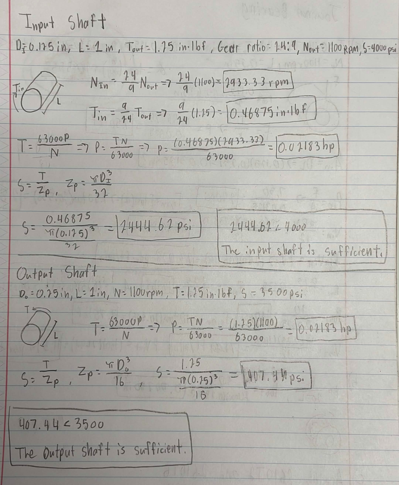

## Journal Bearing Design
For my shaft design, I followed the same guidelines that I did for my shaft design. This time, I solved for thickness, velocity and forces. I solved for input and output of the journal bearing. I also selected journal bearings off of McMaster-Carr that had the correct dimensions. In the image below are my calculations.

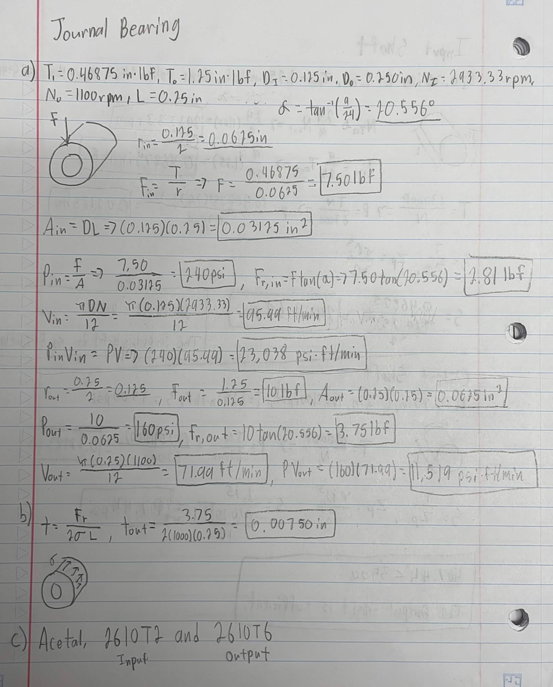

## Gearbox Housing Sketch & CAD
Now that I have all of my necessary calculations, I started to design the gearbox housing and how it will be fit together using pins that plug into each other. 

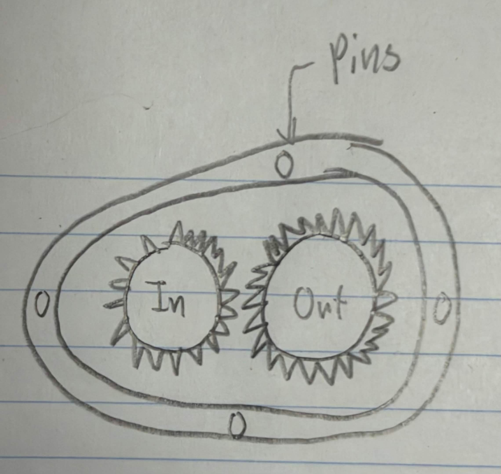

Now that I had a design, it was time to begin the CAD model. I used parametric equations in order to determine my dimensions for my housing and began the sketch off of these dimensions.  

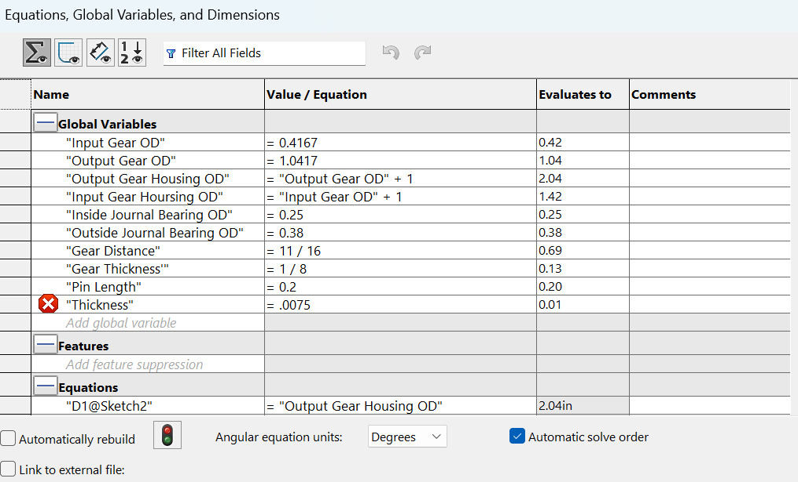
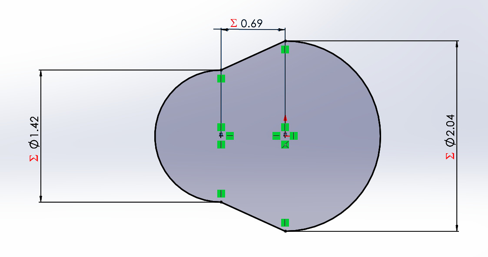
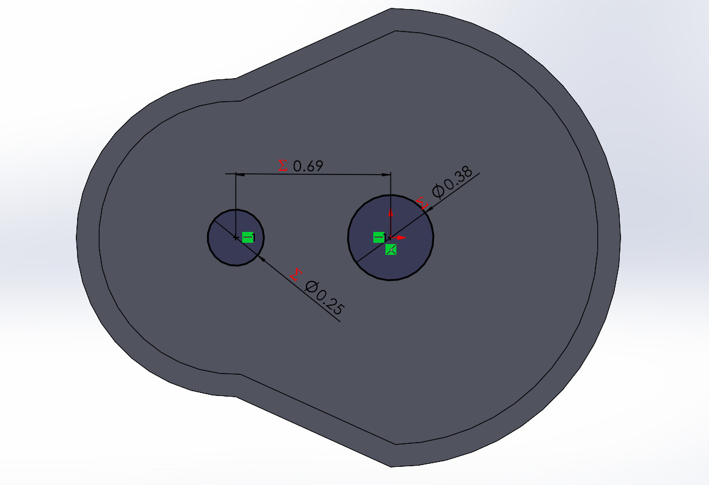
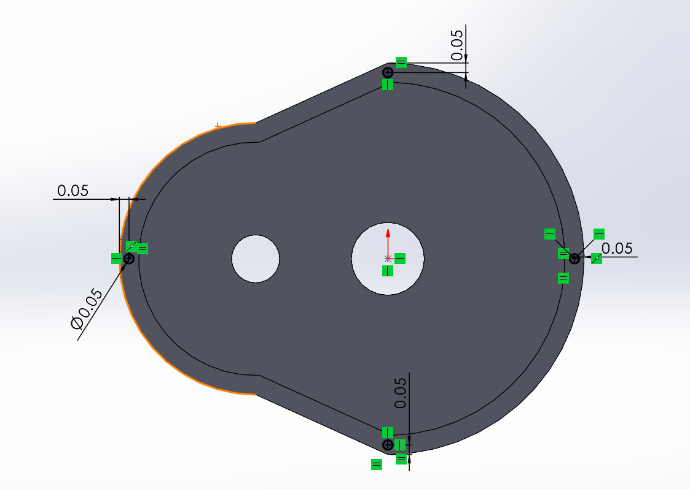
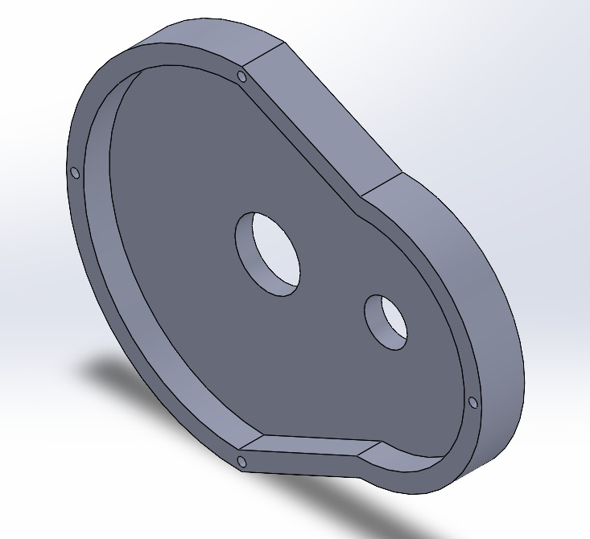

With one half of the housing complete, I made a copy and replaced the holes with pins so my housing would fit together. With the gearbox complete it was time to create my assembly. I installed the McMaster-Carr Solidworks plugin and used it to import gears, shafts and bearings. I imported Metal Gear 7880K19, Metal Gear 7880K24, Rotary Shaft 1327K93, Rotary Shaft 1327K113, Acetal Dry-Running Sleeve Bearing 2610T2 and Acetal Dry-Running Sleeve Bearing 2610T6. I determined the rotary shafts based off the diameters of the journal bearings and the gear diameter. With all of the components selected, I created my assembly. 

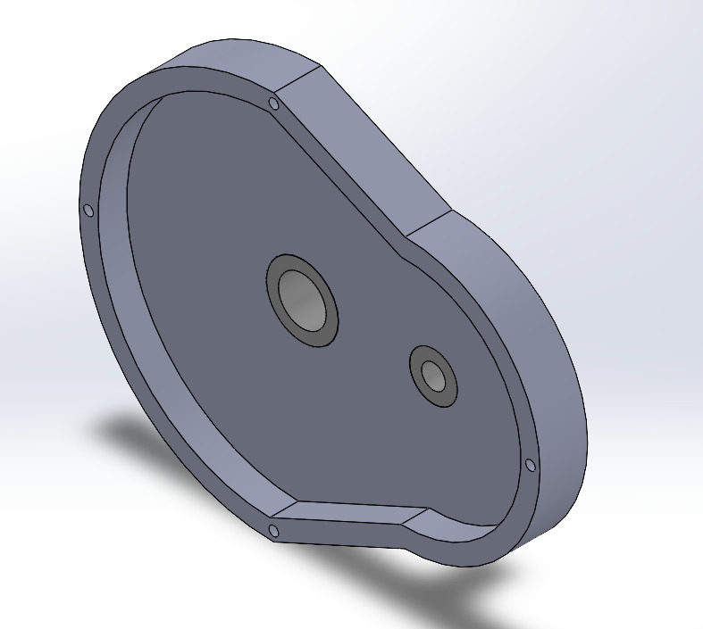
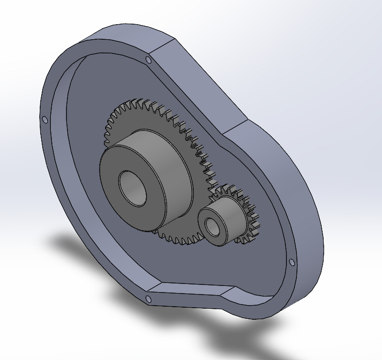
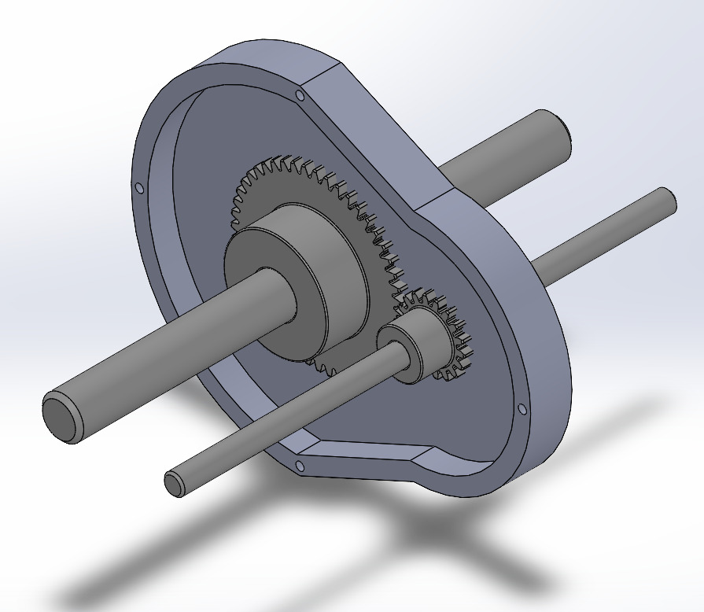
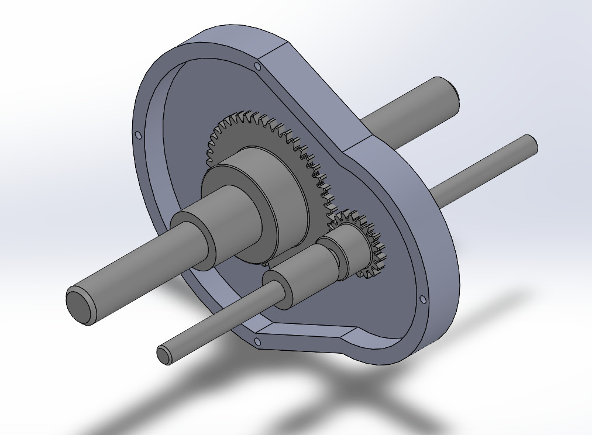
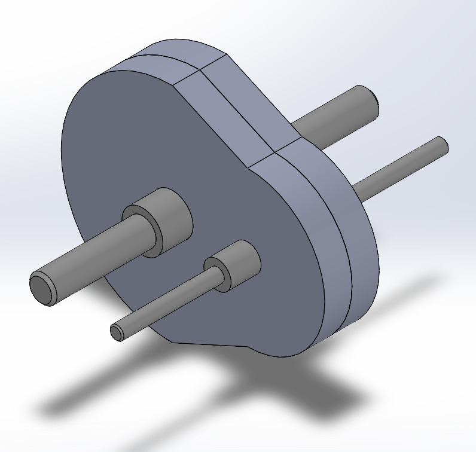

## Lessons Learned

## CAD & 2157
[A8Gearbox.zip](A8Gearbox.zip)
