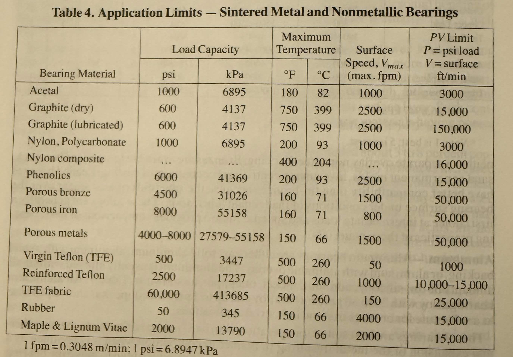
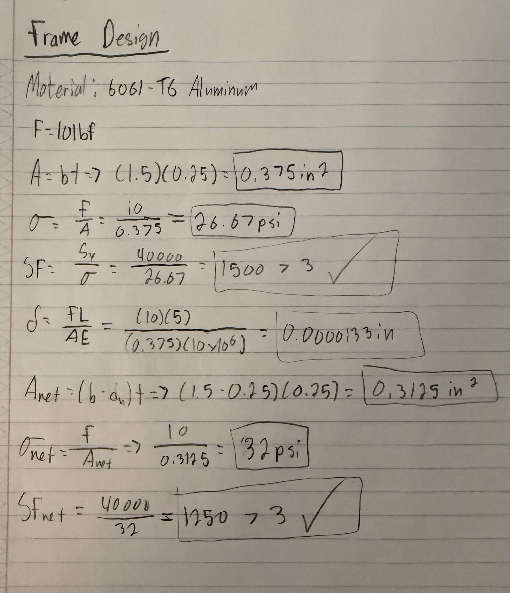

# A9 – Pulley

## Objective
For this assignment, we we're tasked to design a pulley system to transfer power between two parallel axes separated by a center distance of 4–6 inches. As well as, 

- Pulley Diameter: Both pulleys shall have a diameter of 3 inches.
- Rotational Speed: Select an operating speed between 1000–2000 rpm.
- Belt Tension (Static): Select a belt tension between 4–6 lbf under stationary conditions.
- Material: Pulleys may be made from aluminum, ABS, or steel, and may include a groove and shaft diameter of your choosing (within reasonable manufacturing limits).
- Safety Factor: The design must satisfy a minimum safety factor of 3.
- Assume the belt is made from polyurethane rubber, with a yield strength of 3.25 MPa (471 psi) at 20% strain, based on: Wanga, Chena, Wua, Zhangb, Suna, “Strain-induced Structural and Dynamic Changes in Segmented Polyurethane Elastomers.”

## Belt and Minimum Diameter
I started off with the belt design. In order to do this, I started off listing my known and unknowns and drew out a FBD. Then I calculated my forces on the belt. After solving my forces, I then solved my belt diameter and area. Finally, I solved the circumference and length.

Once the belt design was calculated, I then determined the minimum diameter of the shaft given the maximum stress allowance for the material of the shaft, which is 1060 hardened steel. I algebraically solved for power then plugged it into the diameter equation. In the image below are my calculations.

## Journal Bearing and Frame Design
Following these calculations, I then moved onto my journal bearing design. I started off with the same strategy as before, by listing my knowns and unknowns first and then drawing a FBD. I solved my force and area. Then I solved for pressure, linear velocity and the PV rating. Finally, using the PV rating, I went to Table 4 on page 2440 in the Machinery’s Handbook to determine a material.

With the material and calculations now determined, it was time to design a frame. I started off with sketching out a design. This, as well as all the calculations and material selection, can be found in the images below.

For my engineering analysis, I chose 6061-T6 Aluminum as my material as it meets the minimum safety factor of 3. I calculated my net area, net stress and net safety factor. In the image below I showed my calculated values.

## Lessons Learned
This assignment gave me a better understanding of pulley systems. I learned how belt tension, friction, and how pulley systems influence the forces that are transmitted through a system. I also learned how the torque affects shaft diameter and how material yield strength influences shaft design. In total, this assignment took me 4 hours to complete.
