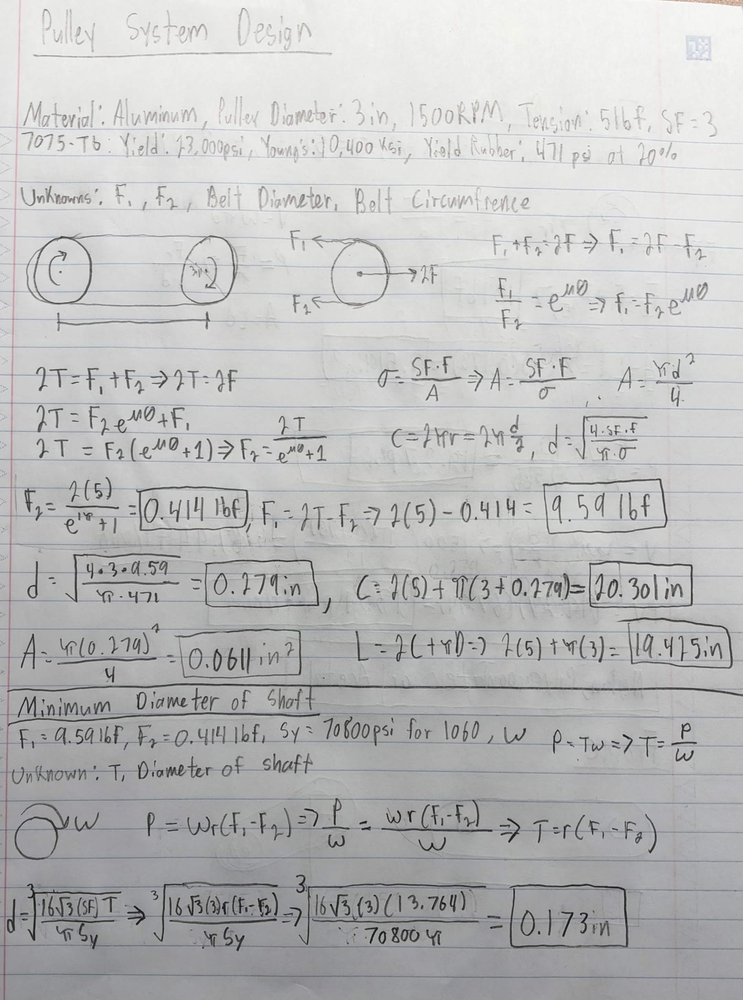
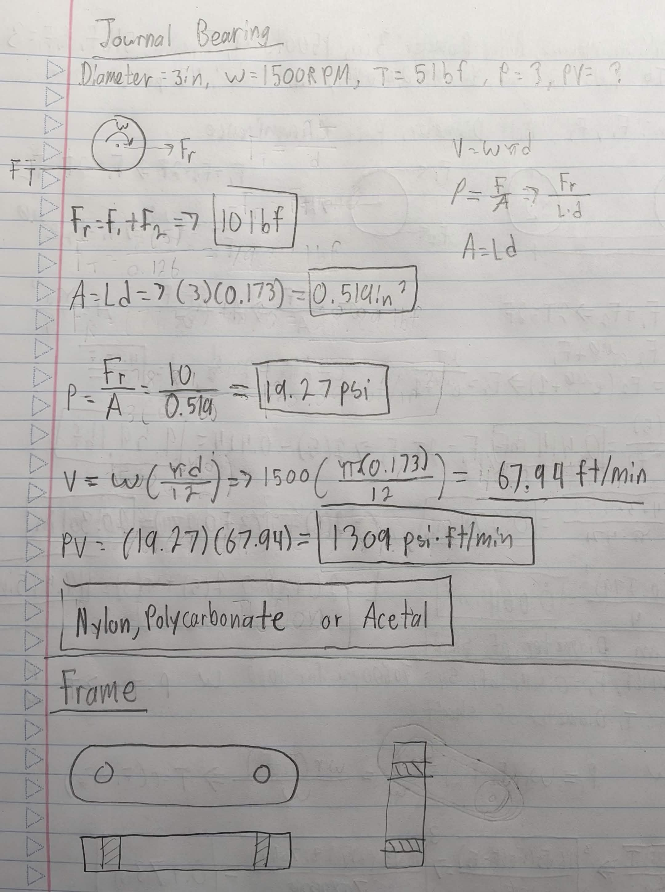

# A9 – Pulleys

## Objective
For this assignment, we we're tasked to design a pulley system to transfer power between two parallel axes separated by a center distance of 4–6 inches. As well as, 
- Pulley Diameter: Both pulleys shall have a diameter of 3 inches.
- Rotational Speed: Select an operating speed between 1000–2000 rpm.
- Belt Tension (Static): Select a belt tension between 4–6 lbf under stationary conditions.
- Material: Pulleys may be made from aluminum, ABS, or steel, and may include a groove and shaft diameter of your choosing (within reasonable manufacturing limits).
- Safety Factor: The design must satisfy a minimum safety factor of 3.
- Assume the belt is made from polyurethane rubber, with a yield strength of 3.25 MPa (471 psi) at 20% strain, based on: Wanga, Chena, Wua, Zhangb, Suna, “Strain-induced Structural and Dynamic Changes in Segmented Polyurethane Elastomers.”

## Belt and Minimum Diameter

## Journal Bearing and Frame Design

## Lessons Learned

